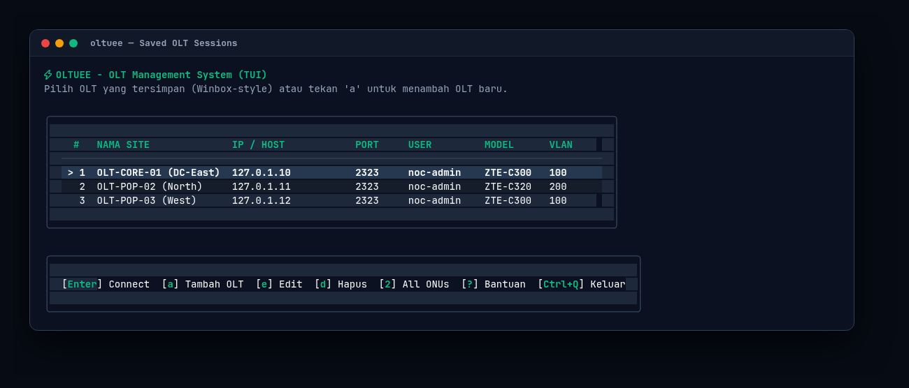
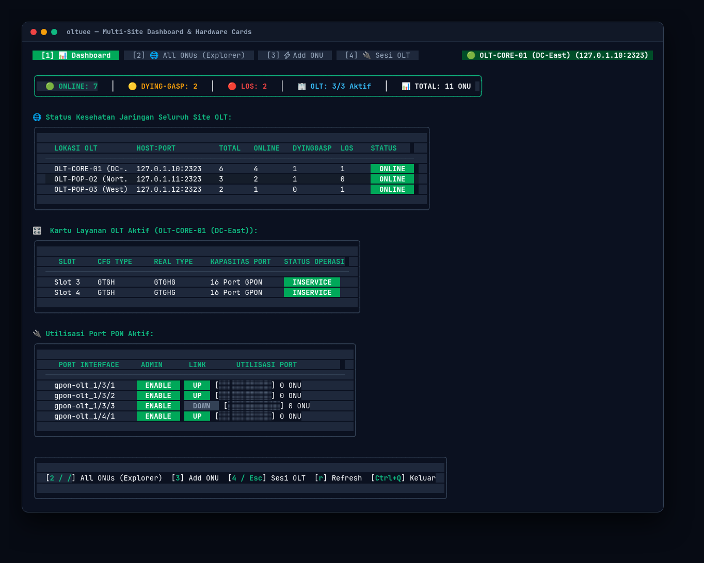
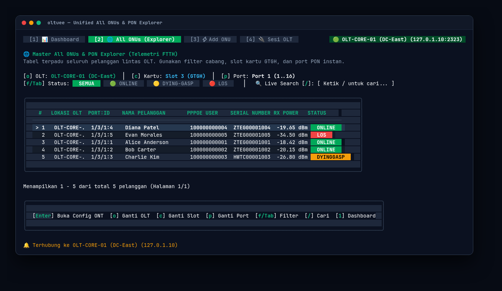
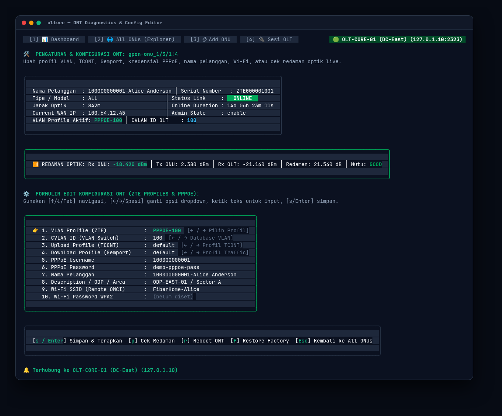
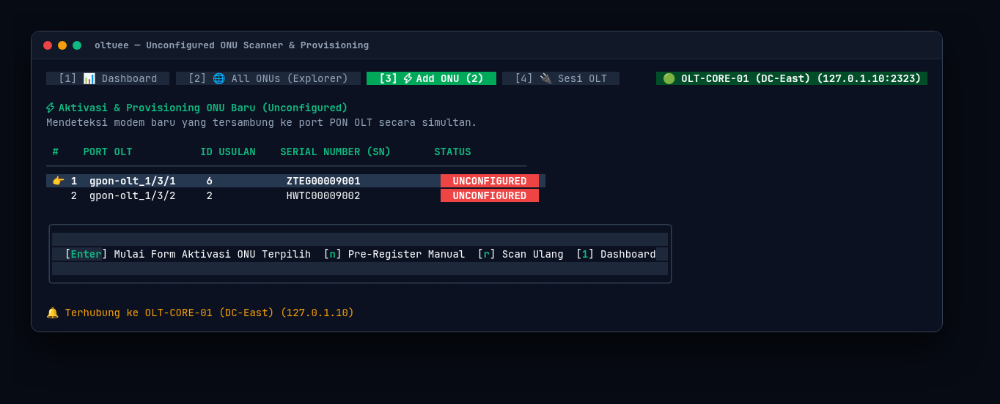

# ⚡ OLTUEE — Sistem Manajemen OLT Berbasis Terminal (TUI)

[](https://github.com/mfayaadh/oltuee/actions/workflows/ci.yml)
[](LICENSE)

> **Language / Bahasa:** [English](README.md) | Bahasa Indonesia

**OLTUEE** adalah aplikasi Terminal User Interface (TUI) yang ringan dan cepat untuk mengelola, memantau, dan mem-provisioning **OLT ZTE GPON** secara langsung melalui Telnet — dibangun menggunakan **Go** dan **Charmbracelet Bubble Tea**.

Dirancang sebagai alternatif ringan pengganti NMS berbasis Java/Oracle yang berat (seperti NetNumen U31), OLTUEE dikompilasi menjadi satu binary tunggal (~7 MB) yang langsung berjalan dalam milidetik dan nyaman digunakan melalui terminal lokal maupun SSH jump host.

---

## 🎯 Tipe OLT & Protokol yang Didukung

| Kategori | Status | Keterangan |
| :--- | :--- | :--- |
| **ZTE ZXA10 C300** | ✅ Didukung | Diuji dengan kartu layanan GPON GTGH/GTGHG 16-port via Telnet CLI |
| **ZTE ZXA10 C320** | ✅ Didukung | Menggunakan perintah CLI GPON ZXA10 yang kompatibel via Telnet |
| **ZTE ZXA10 C600** | 🧪 CLI Kompatibel | Mengikuti sintaks ZXA10 GPON (masukan & pengujian sangat terbuka) |
| **Transport SSH** | 🛣️ Rencana | Saat ini menggunakan koneksi Telnet |
| **HSGQ / Huawei** | 🛣️ Rencana | Abstraksi driver (`olt.Client`) siap untuk penambahan vendor lain |

---

## 📸 Tangkapan Layar (Screenshots)

### 1. Daftar Sesi OLT (Winbox-style Session Manager)
Kelola banyak profil OLT dalam satu daftar dengan quick-connect, tambah (`a`), edit (`e`), dan hapus (`d`):



### 2. Dashboard Multi-Site & Status Kartu Hardware
Ringkasan agregat ONU Online / Dying-Gasp / LOS lintas seluruh site OLT beserta status kartu layanan GTGH dan port PON pada OLT aktif:



### 3. Master All ONUs & PON Explorer
Filter pelanggan lintas OLT atau pilih OLT (`o`), slot kartu GTGH (`c`), port PON 1–16 (`p`), status (`f`/`Tab`), serta Live Search instan (`/`) berdasarkan nama pelanggan, username PPPoE, Serial Number, maupun interface:



### 4. Diagnostik ONT, Redaman Optik Live & Editor Konfigurasi
Pantau Rx/Tx optik sisi ONU & OLT, total redaman (dB), jarak optik, durasi online, IP WAN PPPoE, serta ubah profil VLAN, T-CONT, GEMPort, akun PPPoE, nama pelanggan, Wi-Fi (OMCI), hingga reboot (`r`) dan factory reset (`f`):



### 5. Scanner ONU Unconfigured & Wizard Aktivasi
Deteksi otomatis modem baru yang belum teregistrasi (`show gpon onu uncfg`) dan lakukan provisioning langsung atau pre-register manual (`n`):



---

## ⚙️ Cara Kerja

OLTUEE terhubung langsung ke OLT ZTE ZXA10 melalui TCP/Telnet (`internal/olt/telnet.go` & `internal/olt/zte_c300.go`) tanpa memerlukan database eksternal, Redis, maupun web server:

1. **Mesin Telnet Ter-serialisasi**:
   - Menangani negosiasi Telnet IAC, `terminal length 0`, dan pagination `--More--` otomatis.
   - Menggunakan `sync.Mutex` dan deteksi prompt berbasis regex agar output perintah tidak saling bertabrakan.
   - Mengirimkan `exit` saat koneksi ditutup untuk mencegah sesi VTY pada OLT penuh/tersangkut.
2. **Sinkronisasi Paralel & Cache Lokal**:
   - Saat aplikasi dibuka atau ditekan `r`, OLTUEE menyinkronkan `show gpon onu state` dan `show gpon onu baseinfo gpon-olt_<port>` secara paralel ke semua OLT tersimpan.
   - Metadata ONU (nama pelanggan, username PPPoE, SN, model, status) disimpan pada cache lokal di `~/.config/oltuee/cache/<host>.json` agar pencarian dan navigasi tetap instan.
3. **Perintah CLI ZTE yang Digunakan**:
   - **Hardware & Status:** `show card`, `show gpon olt interface`, `show gpon onu state`, `show gpon onu baseinfo`, `show gpon onu uncfg`.
   - **Telemetri ONT:** `show gpon onu detail-info`, `show gpon remote-onu wan-ip`, `show gpon remote-onu ssid`, `show pon power attenuation` (fallback `show pon power onu-rx`).
   - **Profil OLT:** `show gpon profile tcont`, `show gpon profile traffic`, `show gpon onu profile vlan`, `show vlan summary`.
   - **Provisioning & Aksi:** Registrasi ONU (`onu <id> type ALL sn <sn>`), set `tcont`/`gemport`/`service-port`, konfigurasi `pon-onu-mng` (PPPoE WAN & Wi-Fi OMCI), reboot, restore factory, dan hapus ONU.

### Konvensi & Catatan Konfigurasi OLT
- **Parsing Nama & PPPoE:** Mengekstrak nama pelanggan dan username PPPoE dari field `name` / `description` dengan format seperti `<pppoe>-<nama>`, `<nama>-<pppoe>`, `<nama> | <pppoe>`, atau `<id>$$<pppoe>-<nama>$$`.
- **Default Provisioning:** Wizard aktivasi memakai `onu <id> type ALL sn <sn>`, `tcont 1 profile default`, `gemport 1 tcont 1`, `service-port 1 vport 1 user-vlan <vlan> vlan <vlan>`, dan `wan-ip 1 mode pppoe`. Pastikan profil T-CONT `default` dan profil VLAN sudah tersedia di OLT (atau sesuaikan melalui editor ONT setelah aktivasi).
- **Ambang Batas Redaman Optik:**
  - 🟢 **GOOD:** `-14.0` s/d `-24.0 dBm`
  - 🟡 **WARNING:** `-24.0` s/d `-27.0 dBm`
  - 🔴 **CRITICAL:** `< -27.0 dBm` (atau `> -14.0 dBm`)

---

## 🚀 Instalasi & Build

### Prasyarat
- [Go](https://go.dev/dl/) `1.27` atau versi toolchain yang kompatibel (jika build dari source)
- Terminal dengan dukungan 256/TrueColor dan UTF-8 (Windows Terminal, Kitty, Alacritty, WezTerm, Ghostty, iTerm2, GNOME Terminal, dll.)

### Opsi 1: Install via `go install`
```bash
go install github.com/mfayaadh/oltuee@latest
```

### Opsi 2: Build dari Source (Linux / macOS)
```bash
git clone https://github.com/mfayaadh/oltuee.git
cd oltuee
go build -o oltuee main.go
./oltuee
```

### Opsi 3: Cross-Compile untuk Windows (`oltuee.exe`)
Anda bisa mengkompilasi binary Windows langsung dari Linux/macOS tanpa menginstall Go di Windows:
```bash
GOOS=windows GOARCH=amd64 go build -o oltuee.exe main.go
```
Jalankan file `oltuee.exe` langsung melalui **Windows Terminal** atau PowerShell.

---

## 🔧 Penyimpanan Konfigurasi & Cache

Pada pemakaian pertama, daftar sesi OLT dimulai dalam kondisi kosong. Tekan `a` pada halaman Sesi OLT untuk menambahkan koneksi OLT Anda.

- **Profil Sesi OLT:** `~/.config/oltuee/sessions.json` (izin file `0600`)
- **Cache Data ONU:** `~/.config/oltuee/cache/<host>.json` (izin file `0600`)
- **Direktori Kustom:** Atur environment variable `OLTUEE_DATA_DIR=/path/kustom` jika ingin mengubah lokasi penyimpanan default.

---

## ⌨️ Pintasan Tombol (Keybindings)

| Konteks | Tombol | Fungsi |
| :--- | :--- | :--- |
| **Global** | `Ctrl+Q` / `Ctrl+C` | Keluar dari aplikasi secara aman (menutup socket Telnet) |
| **Navigasi** | `1` | Buka Dashboard Multi-Site & OLT Aktif |
| | `2` | Buka All ONUs & PON Explorer |
| | `3` | Buka Scanner ONU Unconfigured & Wizard Aktivasi |
| | `4` / `Esc` | Buka Daftar Sesi OLT (memutus koneksi OLT aktif dari Dashboard) |
| | `?` | Buka Panduan Keybindings |
| | `r` | Refresh data langsung dari OLT / sinkronkan seluruh site |
| **Sesi OLT (`[4]`)** | `↑` / `↓` atau `j` / `k` | Navigasi daftar OLT |
| | `Enter` | Hubungkan ke OLT terpilih |
| | `a` / `e` / `d` | Tambah / Edit / Hapus sesi OLT |
| **ONU Explorer (`[2]`)** | `/` | Mulai Live Search (`Esc` hapus pencarian, `Enter` kunci filter) |
| | `o` / `c` / `p` | Pilih Cabang OLT / Slot Kartu GTGH / Port PON (`1`–`16`) |
| | `←` / `→` atau `[` / `]` | Pindah Port PON sebelumnya / berikutnya |
| | `f` / `Tab` | Ganti filter status (`SEMUA` → `ONLINE` → `DYING-GASP` → `LOS`) |
| | `PgUp` / `PgDn` | Halaman sebelumnya / berikutnya |
| | `Enter` | Buka Detail & Editor Konfigurasi ONT |
| **Detail ONT** | `↑` / `↓` atau `Tab` | Navigasi field konfigurasi |
| | `←` / `→` / `Spasi` | Pilih opsi dropdown (VLAN Profile, CVLAN, T-CONT, GEMPort) |
| | `s` / `Enter` | Simpan & terapkan konfigurasi ke OLT |
| | `p` / `r` / `f` | Cek ulang redaman optik / Reboot ONT / Restore Factory |
| | `Esc` | Kembali ke ONU Explorer |
| **Aktivasi (`[3]`)** | `Enter` | Buka form aktivasi untuk ONU unconfigured terpilih |
| | `n` | Buka form pre-register manual |

---

## 🔒 Catatan Keamanan

- **Penyimpanan Kredensial Lokal:** File `~/.config/oltuee/sessions.json` menyimpan username dan password OLT dalam format JSON plaintext (dengan permission `0600`). Jangan pernah meng-commit `sessions.json` atau folder `cache/` ke repository publik.
- **Protokol Telnet:** Koneksi ke OLT saat ini menggunakan Telnet yang tidak terenkripsi. Pastikan OLTUEE dijalankan melalui jaringan manajemen terisolasi, VPN (WireGuard/Tailscale/IPsec), atau SSH jump host.

---

## 🤝 Kontribusi & Lisensi

Kontribusi sangat terbuka — terutama untuk penambahan driver vendor lain (HSGQ, Huawei, FiberHome, C-Data) melalui interface `olt.Client` ([internal/olt/client.go](internal/olt/client.go)), dukungan SSH, maupun terjemahan antarmuka.

Aplikasi ini dirilis dengan lisensi **Open Source MIT** ([LICENSE](LICENSE)).
