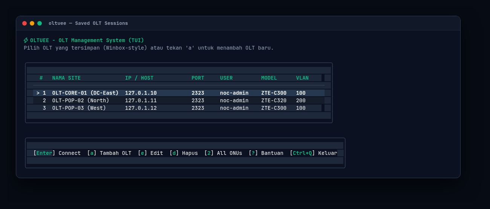
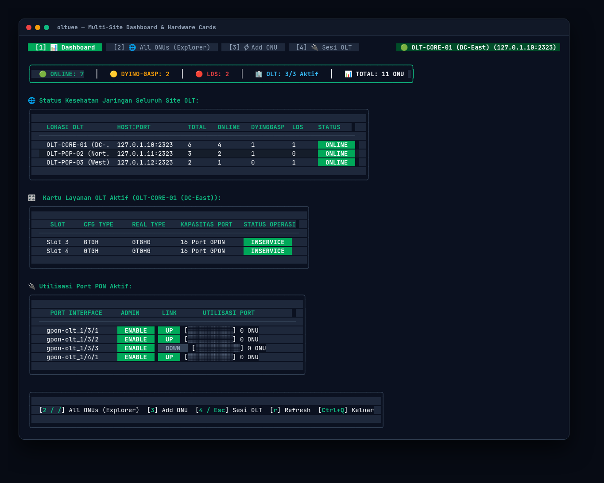
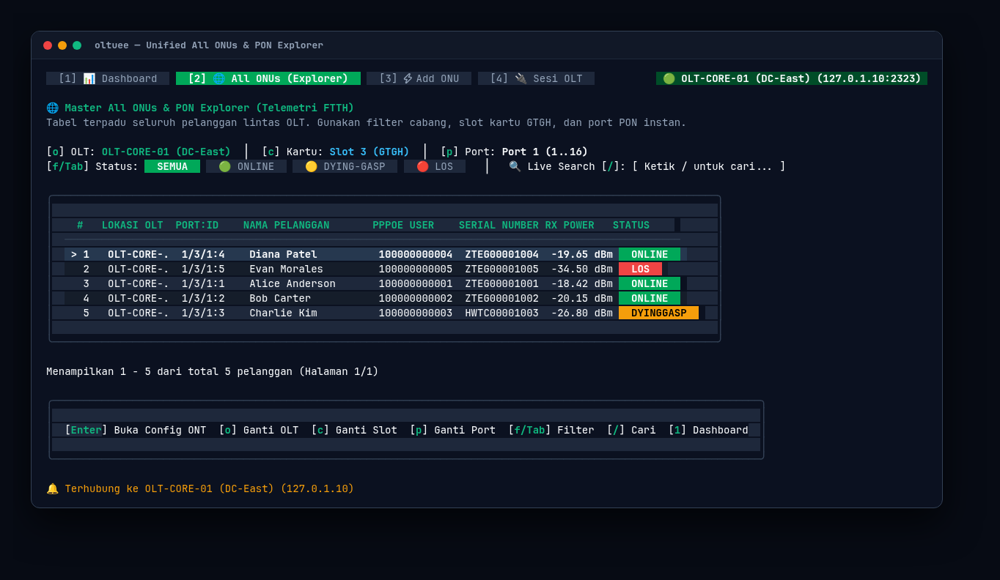
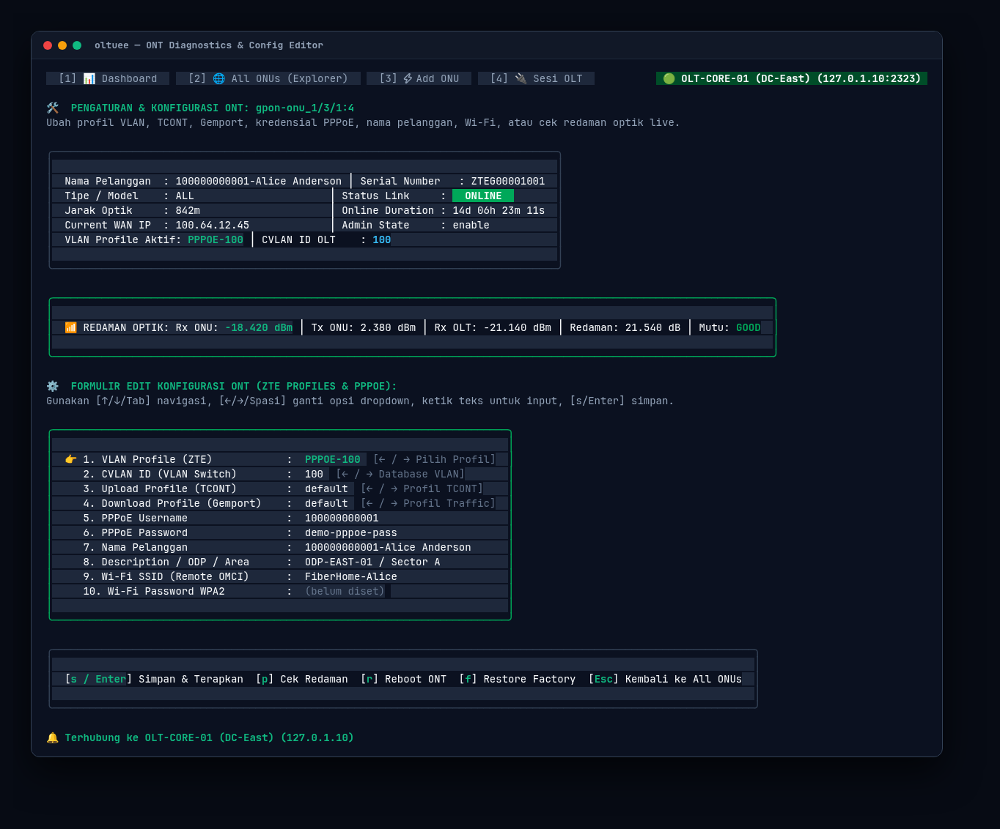
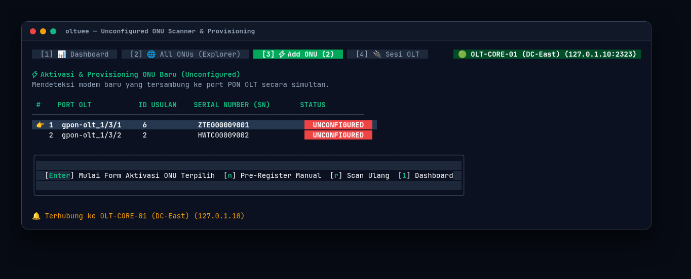

# ⚡ OLTUEE — Lightweight TUI OLT Management System

[](https://github.com/mfayaadh/oltuee/actions/workflows/ci.yml)
[](LICENSE)

> **Language / Bahasa:** English | [Bahasa Indonesia](README.id.md)

**OLTUEE** is a fast, lightweight Terminal User Interface (TUI) for managing, monitoring, and provisioning **ZTE GPON OLTs** directly over Telnet — built with **Go** and **Charmbracelet Bubble Tea**.

Designed as a zero-overhead alternative to heavy Java/Oracle-based vendor NMS tools (such as NetNumen U31), OLTUEE compiles into a single standalone binary (~7 MB) that starts instantaneously and works cleanly over SSH jump hosts or local terminals.

---

## 🎯 Supported Hardware & Protocols

| Category | Status | Notes |
| :--- | :--- | :--- |
| **ZTE ZXA10 C300** | ✅ Supported | Tested with GTGH/GTGHG 16-port GPON line cards via Telnet CLI |
| **ZTE ZXA10 C320** | ✅ Supported | Uses compatible ZXA10 GPON CLI commands via Telnet |
| **ZTE ZXA10 C600** | 🧪 Compatible CLI | Follows ZXA10 GPON syntax (testing & feedback welcome) |
| **SSH Transport** | 🛣️ Planned | Currently Telnet only |
| **HSGQ / Huawei** | 🛣️ Planned | Driver abstraction (`olt.Client`) is ready for additional vendors |

> [!NOTE]
> The interactive TUI labels and status messages are currently in **Indonesian** (widely used by ISP & FTTH NOC teams in Indonesia). Pull requests for multi-language/English UI support are welcome!

---

## 📸 Screenshots

### 1. Saved OLT Sessions (Winbox-style Manager)
Manage multiple OLT sites in one place with quick-connect, add (`a`), edit (`e`), and delete (`d`):



### 2. Multi-Site Health Dashboard & Hardware Cards
Aggregate Online / Dying-Gasp / LOS counts across all configured OLTs alongside live GTGH slot and PON port status on the connected OLT:



### 3. Unified All ONUs & PON Explorer
Filter across all OLT sites or drill down by OLT (`o`), GTGH card slot (`c`), PON port 1–16 (`p`), status badges (`f`/`Tab`), and instant multi-token search (`/`) across customer names, PPPoE usernames, Serial Numbers, and interfaces:



### 4. ONT Live Diagnostics, Optical Power & Config Editor
Inspect live ONU/OLT Rx & Tx optical power, attenuation, distance, uptime, WAN IP, and edit VLAN profiles, T-CONT/GEMPort traffic profiles, PPPoE credentials, customer metadata, and OMCI Wi-Fi settings — plus remote reboot (`r`) and factory reset (`f`):



### 5. Unconfigured ONU Scanner & Provisioning Wizard
Automatically scan `show gpon onu uncfg` and provision newly connected ONUs (or pre-register manually with `n`):



---

## ⚙️ How It Works

OLTUEE communicates directly with ZTE ZXA10 OLTs over TCP/Telnet (`internal/olt/telnet.go` and `internal/olt/zte_c300.go`) without requiring SNMP databases, web backends, or external agents:

1. **Serialized Telnet Engine**:
   - Handles Telnet IAC negotiation, `terminal length 0`, and automatic `--More--` pagination.
   - Protects interactive sessions with a `sync.Mutex` and prompt-regex detection so concurrent operations never interleave CLI output.
   - Sends `exit` cleanly before closing sockets to avoid exhausting OLT VTY lines.
2. **Multi-Site Parallel Sync & Local Cache**:
   - On startup and refresh (`r`), OLTUEE concurrently queries `show gpon onu state` and per-port `show gpon onu baseinfo gpon-olt_<port>` across configured sessions.
   - Parsed metadata (customer name, PPPoE username, SN, model, state) is cached locally in `~/.config/oltuee/cache/<host>.json` for fast browsing and global search.
3. **Native ZTE CLI Operations**:
   - **Discovery & Health:** `show card`, `show gpon olt interface`, `show gpon onu state`, `show gpon onu baseinfo`, `show gpon onu uncfg`.
   - **Live ONT Telemetry:** `show gpon onu detail-info`, `show gpon remote-onu wan-ip`, `show gpon remote-onu ssid`, `show pon power attenuation` (falls back to `show pon power onu-rx`).
   - **Profile Discovery:** `show gpon profile tcont`, `show gpon profile traffic`, `show gpon onu profile vlan`, `show vlan summary`.
   - **Provisioning & Maintenance:** Registers ONUs (`onu <id> type ALL sn <sn>`), sets `tcont` / `gemport` / `service-port`, configures `pon-onu-mng` PPPoE WAN & OMCI Wi-Fi, reboots, restores factory defaults, or deletes ONUs.

### OLT Conventions & Requirements
- **Name / Description Parsing:** Extracts customer names and PPPoE usernames from `name` or `description` lines formatted such as `<pppoe>-<name>`, `<name>-<pppoe>`, `<name> | <pppoe>`, or `<id>$$<pppoe>-<name>$$`.
- **Provisioning Wizard Defaults:** Initial ONU registration sets `onu <id> type ALL sn <sn>`, `tcont 1 profile default`, `gemport 1 tcont 1`, `service-port 1 vport 1 user-vlan <vlan> vlan <vlan>`, and `wan-ip 1 mode pppoe`. Ensure your OLT has a `default` T-CONT profile (or customize the profile via the interactive ONT Config editor after creation).
- **Optical Signal Thresholds:**
  - 🟢 **GOOD:** `-14.0` to `-24.0 dBm`
  - 🟡 **WARNING:** `-24.0` to `-27.0 dBm`
  - 🔴 **CRITICAL:** `< -27.0 dBm` (or `> -14.0 dBm`)

---

## 🚀 Installation & Build

### Prerequisites
- [Go](https://go.dev/dl/) `1.27` or compatible toolchain (if building from source)
- A terminal supporting 256/TrueColor and UTF-8 (e.g., Windows Terminal, Kitty, Alacritty, WezTerm, Ghostty, iTerm2, GNOME Terminal)

### Option 1: Install via `go install`
```bash
go install github.com/mfayaadh/oltuee@latest
```

### Option 2: Build from Source (Linux / macOS)
```bash
git clone https://github.com/mfayaadh/oltuee.git
cd oltuee
go build -o oltuee main.go
./oltuee
```

### Option 3: Cross-Compile for Windows (from Linux / macOS)
```bash
GOOS=windows GOARCH=amd64 go build -o oltuee.exe main.go
```
Copy `oltuee.exe` to your Windows machine and launch it from **Windows Terminal** or PowerShell.

---

## 🔧 Configuration & Data Paths

On first run, OLTUEE initializes an empty session store. Press `a` in the Saved Sessions screen to add your first OLT.

- **Saved OLT Sessions:** `~/.config/oltuee/sessions.json` (saved with `0600` permissions)
- **ONU Metadata Cache:** `~/.config/oltuee/cache/<host>.json` (saved with `0600` permissions)
- **Custom Data Directory:** Set `OLTUEE_DATA_DIR=/path/to/dir` to override `~/.config/oltuee`.

---

## ⌨️ Keybindings

| Context | Key | Action |
| :--- | :--- | :--- |
| **Global** | `Ctrl+Q` / `Ctrl+C` | Quit OLTUEE cleanly (closes active Telnet socket) |
| **Navigation** | `1` | Open Multi-Site & Active OLT Dashboard |
| | `2` | Open Unified All ONUs & PON Explorer |
| | `3` | Open Unconfigured ONU Scanner & Activation Wizard |
| | `4` / `Esc` | Open Saved OLT Sessions (disconnects active OLT from Dashboard) |
| | `?` | Open Keybindings Help |
| | `r` | Refresh live OLT data / sync multi-site metrics |
| **Sessions (`[4]`)** | `↑` / `↓` or `j` / `k` | Navigate OLT list |
| | `Enter` | Connect to selected OLT |
| | `a` / `e` / `d` | Add / Edit / Delete OLT session |
| **ONU Explorer (`[2]`)** | `/` | Start live multi-token search (`Esc` clears, `Enter` confirms) |
| | `o` / `c` / `p` | Select OLT site / GTGH slot / PON port (`1`–`16`) |
| | `←` / `→` or `[` / `]` | Quick-switch previous / next PON port |
| | `f` / `Tab` | Cycle status filter (`ALL` → `ONLINE` → `DYING-GASP` → `LOS`) |
| | `PgUp` / `PgDn` | Previous / next page |
| | `Enter` | Open ONT Detail & Configuration Editor |
| **ONT Detail** | `↑` / `↓` or `Tab` | Navigate config fields |
| | `←` / `→` / `Space` | Cycle dropdowns (VLAN Profile, CVLAN, T-CONT, GEMPort) |
| | `s` / `Enter` | Save & apply ONT configuration to live OLT |
| | `p` / `r` / `f` | Re-check optical power / Reboot ONT / Restore factory defaults |
| | `Esc` | Back to ONU Explorer |
| **Activation (`[3]`)** | `Enter` | Open provisioning wizard for selected unconfigured ONU |
| | `n` | Open manual pre-registration wizard |

---

## 🔒 Security Considerations

- **Plaintext Local Storage:** `~/.config/oltuee/sessions.json` stores OLT login credentials in JSON (`0600` file permissions). Do not commit `sessions.json` or `cache/` files to version control.
- **Telnet Transport:** ZTE OLT connections currently use Telnet, which transmits credentials and CLI traffic unencrypted. Always run OLTUEE over a dedicated management VLAN, VPN (WireGuard/Tailscale/IPsec), or SSH jump host.

---

## 🛠️ Tech Stack

- [Go](https://go.dev/)
- [Charmbracelet Bubble Tea](https://github.com/charmbracelet/bubbletea) — Elm-architecture TUI framework
- [Charmbracelet Lip Gloss](https://github.com/charmbracelet/lipgloss) — Terminal styling & layout
- [Charmbracelet Bubbles](https://github.com/charmbracelet/bubbles) — TUI components

---

## 🤝 Contributing

Contributions are very welcome — especially for:
- Additional OLT vendor drivers (HSGQ, Huawei, FiberHome, C-Data) implementing `olt.Client` (`internal/olt/client.go`)
- SSH transport support alongside Telnet
- Internationalization (English / multi-language UI strings)

Feel free to open an Issue or Pull Request!

## 📄 License

Open Source under the [MIT License](LICENSE).
